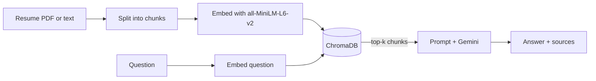

# CareerPath RAG Copilot

A small retrieval-augmented generation (RAG) service that answers questions about a resume, with the source text shown next to every answer. It extends the **CareerPath AI** project: the Flask backend sends resume text to this service, and the Streamlit dashboard has a new **Career Copilot** page for asking questions.

**Stack:** Python, LangChain, ChromaDB, sentence-transformers, Gemini API, FastAPI, MLflow, Docker

## How it works



1. **Indexing:** a resume is split into overlapping chunks, each chunk is turned into an embedding, and the vectors are stored in ChromaDB. Chunks get a hash of their text as an ID, so uploading the same file twice does not create duplicates.
2. **Answering:** the question is embedded, the `k` closest chunks are retrieved, and the LLM is told to answer only from them. If the answer is not in the context, it says so.
3. **Sources:** every response returns the retrieved chunks, so you can check what the answer was based on.

## API

| Method | Endpoint | Purpose |
|---|---|---|
| GET | `/health` | Health check |
| POST | `/upload` | Upload a PDF (`file`, `doc_type`) and index it |
| POST | `/ingest-text` | Index plain text (used by the CareerPath Flask backend) |
| POST | `/ask` | `{"question": "...", "top_k": 4}` returns `answer` and `sources` |

Interactive docs are at `http://127.0.0.1:8000/docs`.

## Project layout

```
rag_service/
├── app/
│   ├── config.py       # settings from environment variables
│   ├── ingest.py       # load, chunk, embed, store
│   ├── rag_chain.py    # retriever + prompt + LLM
│   └── main.py         # FastAPI endpoints
├── eval/
│   ├── questions.json  # test questions with expected keywords
│   └── run_eval.py     # experiments logged to MLflow
├── Dockerfile
├── requirements.txt
└── README.md
```

## Run locally

```bash
cd rag_service
python -m venv .venv && source .venv/bin/activate
pip install -r requirements.txt
```

Create `rag_service/.env` (never commit this file):

```
GOOGLE_API_KEY=your_key_here
LLM_MODEL=gemini-3.8-flash
CHUNK_SIZE=500
CHUNK_OVERLAP=83
TOP_K=4
```

Model names change over time, so use whichever model your provider currently lists. Then start the server:

```bash
python -m uvicorn app.main:app --port 8000
```

Upload a resume at `/docs` (POST `/upload`), then ask a question with POST `/ask`.

## Run with Docker

```bash
cd rag_service
docker build -t careerpath-rag .
docker run --rm -p 8000:8000 --env-file .env \
  -v "$(pwd)/chroma_db:/app/chroma_db" careerpath-rag
```

The API key is passed at runtime and is not stored in the image. The embedding model is downloaded during the build, and the vector store is kept on the host through the volume mount. The image uses CPU-only PyTorch to keep its size down.

## Connecting to CareerPath AI

- `backend/app.py` calls `/ingest-text` when a resume is submitted to `/optimize_resume`. If the RAG service is not running, the call is skipped and the original route still works.
- `frontend/dashboard.py` has a **Career Copilot** page that calls `/ask` and shows the answer with its sources.

## Experiments (MLflow)

The retrieval settings were compared on **61 test questions** about one resume. A question counts as a hit when the retrieved chunks contain the expected keyword(s). This measures retrieval only and needs no LLM calls.

**Retrieval hit rate (%)**

| Chunk size (chunks in index) | k=1 | k=2 | k=4 | k=6 |
|---|---|---|---|---|
| 300 (21) | 47.5 | 75.4 | 86.9 | 90.2 |
| 500 (13) | 54.1 | 75.4 | 90.2 | 93.4 |
| 800 (9) | 70.5 | 85.2 | 90.2 | 91.8 |
| 1200 (6) | 62.3 | 80.3 | 95.1 | 95.1 |

What the results show:

- **`k` matters most.** Going from k=1 to k=4 adds 25 to 40 points. From k=4 to k=6 it adds 0 to 3.
- **The best raw score is chunk 1200 with k=4 (95.1%),** but with only 6 chunks in the index it retrieves about two thirds of a two-page resume, so part of that score is just "send most of the document".
- **Chunk 500 with k=4 reaches 90.2% with less than half the context,** which means lower cost and less noise for the LLM. That is the setting used by default here.

**End-to-end answer accuracy (LLM)**

| Setting | Questions | Answer accuracy |
|---|---|---|
| chunk 500, k=4 | first 15 of 61 | _to be filled after the run_ |

Run it with:

```bash
cd rag_service
python -m eval.run_eval                                   # retrieval grid, no API calls
EVAL_LLM=1 BEST_CHUNK=500 BEST_K=4 python -m eval.run_eval   # one LLM run (about 15 calls)
mlflow ui --port 5050                                     # compare runs
```

## Limitations

- The test set is small and was written from a single resume, so the numbers show relative differences between settings, not general quality.
- Scoring is keyword matching. It can miss a correct answer that is worded differently, and it can accept a wrong answer that happens to contain the keyword.
- The LLM evaluation uses a subset of questions because the free API tier allows only a few requests per day.
- The hit rate of a retrieval setting does not guarantee the LLM answers correctly. The end-to-end number above measures that separately.
- Resume text is sent to a third-party LLM API when you ask a question. Do not index documents you are not comfortable sharing with that provider.

## Possible next steps

- Add a reranker and compare it against plain similarity search
- Index job descriptions as a second document type and add a resume-vs-JD gap question
- Score answers with an LLM judge in addition to keyword matching
- Add automated tests and a CI workflow
